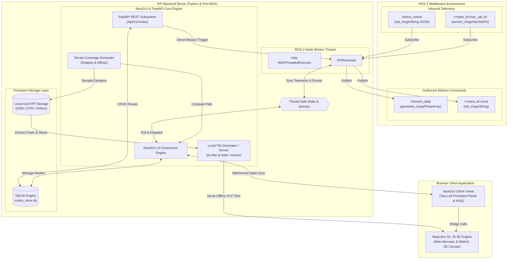

# About <br> ISF's Intelligent Path Planner - IPP
The **Intelligent Path Planner (IPP)** is a web-based UAV mission planning and 3D simulation platform built with Python, NiceGUI, and MapLibre GL JS. It is designed to generate complex, terrain-following flight paths while visualizing the vehicle's movements in a fully interactive 3D map environment.

**Core Capabilities:**

* **Interactive 3D Mapping:** Renders a 3D globe where users can toggle default basemaps, enable 3D terrain meshes, or add custom online XYZ tile servers.
* **Advanced Path Generation:** Automatically computes "Lawnmower" or "Grid" coverage patterns within user-drawn boundaries. It features a real-time azimuth slider that dynamically rotates the pattern and mathematically routes the UAV to the optimal starting corner.
* **Terrain-Following & Geospatial Import:** Calculates precise Above Ground Level (AGL) altitudes by combining base map data with user-uploaded, high-resolution DSM, DTM, and Orthomosaic `.tif` files.
* **Live Flight Simulation:** Features a customizable 3D UAV marker with a geographically accurate ground shadow, dynamic speed controls, "Set Start" teleportation, and a live telemetry HUD tracking Longitude, Latitude, and Mean Sea Level (MSL) altitude.
* **Waypoint Actions & Looping:** Supports manual waypoint placement with assigned actions (e.g., Take Photo, Hover) and automatically detects closed routes to generate continuous orbiting loops.
* **Mission Export:** Downloads finalized flight paths and area boundaries as GeoJSON, KML, or KMZ files for deployment to actual flight hardware.

# Implemented functionality - An Overview
| Category | Feature / Requirement | Description |
| --- | --- | --- |
| **System Identity** | Project Title & Port | "intelligent path planer - IPP" running on a Python backend at port 8091 using NiceGUI and MapLibre GL JS. |
| **User Interface** | Persistent Planning Panel | A fixed top-left control card containing the ISF logo, boundary/waypoint selectors, action drop-downs, and coverage pattern settings. |
| **User Interface** | Floating Toolbars | Quick-access buttons for Flight Parameters, Uploads, Server Management, and Export, plus a vertical drone speed slider on the right side. |
| **Map & Visuals** | Online Server Manager | UI to toggle default map/terrain and add custom XYZ tile servers for both 2D raster basemaps and 3D terrain meshes (`raster-dem`). |
| **Map & Visuals** | 3D UAV & Shadow | The UAV is visualized as a 3D extruded disk with a custom physical size (in meters). Its ground shadow scales geographically to match physical dimensions regardless of zoom level. |
| **Map & Visuals** | Layer Filtering | Robust WebGL geometry filters ensuring polygons, lines, and points render simultaneously without crashing the MapLibre engine. |
| **Path Planning** | Start Point Selection | "Set Start" mode allowing the user to click the map to instantly teleport the UAV and sample the local elevation before mission start. |
| **Path Planning** | Coverage Algorithms | Auto-generates standard "Lawnmower" or intersecting "Grid" paths inside drawn boundaries, controlled by a customizable line spacing (m) parameter. |
| **Path Planning** | Live Azimuth Control | A bottom-center 0-180° slider (with a live rotating compass needle) that recalculates pattern heading in real-time, automatically routing the UAV to the nearest starting corner. |
| **Path Planning** | Continuous Looping | If a manual route's final waypoint is placed within 15 meters of the starting point, the path mathematically closes, causing the UAV to orbit endlessly. |
| **Path Planning** | Waypoint Actions | Ability to assign discrete actions (e.g., Take Photo, Start Video, Hover 5s) to individual waypoints or boundary nodes. |
| **Simulation** | Live Telemetry HUD | Bottom-left display actively tracking the UAV's Longitude, Latitude, absolute MSL (Mean Sea Level), and total waypoint count. |
| **Simulation** | Terrain Following | Real-time elevation sampling combining base map math with uploaded high-resolution data to maintain an exact AGL (Above Ground Level) target height. |
| **Data Management** | Local Geospatial Import | Upload `.tif` files directly to the server, categorized as DSM, DTM, or Orthomosaics. Includes a menu to toggle which files actively influence elevation calculations. |
| **Data Management** | Mission Export | Export drawn boundaries and calculated 3D flight paths directly to the user's machine as GeoJSON, KML, or KMZ files. |

# Additional Functionality: <br> Intelligent Path Planner (IPP) — ROS 2 Architecture & Feature Extension Specification

This document provides a comprehensive technical architecture and implementation roadmap to transition the Intelligent Path Planner (IPP) into an offline-capable, multi-robot, ROS 2-integrated ground control and planning platform.

## 1. ROS 2 Environment Integration & Asynchronous IPC

```
+-------------------------------------------------------------------------+
|                              ROS 2 Domain                               |
|                                                                         |
|  [ Robot Fleet ] --- /active_robots (std_msgs/String JSON) -------->+   |
|                  <-- /mission_data  (geometry_msgs/PoseArray) ------+   |
|                  --- /<robot_id>/nav_sat_fix (sensor_msgs/NavSatFix) -> |
+------------------------------------|------------------------------------+
                                     | rclpy Background Thread
                                     v
+------------------------------------+------------------------------------+
|                         IPP Server (Port 8091)                          |
|  +--------------------+   Thread-Safe   +----------------------------+  |
|  | ROS 2 Node Worker  | <=============> | NiceGUI / FastAPI Core     |  |
|  | (MultiThreadSpin)  |      Queue      | (Asyncio Event Loop)       |  |
|  +--------------------+                 +----------------------------+  |
|                                                       |                 |
|                                                       v                 |
|                                            Browser Client (MapLibre)    |
+-------------------------------------------------------------------------+

```

### Problem Statement

The planner must function as a first-class ROS 2 node that communicates seamlessly with the robot fleet over native middleware while keeping the NiceGUI / FastAPI event loop completely responsive and unblocked.

### Technical Implementation

#### Threading Model & Event Loop Decoupling

NiceGUI runs on an asynchronous Uvicorn/FastAPI event loop, whereas [rclpy](https://docs.ros.org/en/rolling/p/rclpy/) requires an executor to handle subscriptions, service calls, and timers. Running `rclpy.spin()` directly inside the async event loop causes starvation.

* **Solution**: Launch a dedicated daemon thread running `rclpy.spin()` with a `MultiThreadedExecutor`.
* **Cross-Thread Synchronization**:
* Incoming ROS data (robot lists, poses) is pushed into standard Python thread-safe queues or atomic dictionaries protected by `threading.Lock`.
* NiceGUI timers (`ui.timer(0.05, poll_ros_events)`) poll this shared memory state and dispatch UI updates via WebSockets to MapLibre GL JS.

#### Topic Contracts

| Topic Name | Direction | Message Type | Purpose |
| --- | --- | --- | --- |
| `/active_robots` | Subscription | `std_msgs/msg/String` (or custom `ipp_interfaces/msg/RobotList`) | Emits JSON-serialized telemetry and IDs of online robots. |
| `/mission_data` | Publication | `geometry_msgs/msg/PoseArray` or `std_msgs/msg/String` | Emits finalized waypoint missions containing 3D coordinates, headings, and payload triggers. |
| `/<robot_id>/nav_sat_fix` | Dynamic Subscription | `sensor_msgs/msg/NavSatFix` | Real-time GPS coordinate telemetry per robot. |
| `/<robot_id>/cmd` | Publication | `std_msgs/msg/String` | Interactive mission triggers (`START`, `PAUSE`, `ABORT`, `RTH`). |

#### Reference Implementation: `ros_bridge.py`

```python
import threading
import json
import rclpy
from rclpy.node import Node
from std_msgs.msg import String
from sensor_msgs.msg import NavSatFix
from geometry_msgs.msg import PoseArray, Pose

class IPPRosNode(Node):
    def __init__(self, state_lock, shared_state):
        super().__init__('intelligent_path_planner')
        self.state_lock = state_lock
        self.shared_state = shared_state
        self.pose_subs = {}

        # Core Topics
        self.create_subscription(String, '/active_robots', self._on_active_robots, 10)
        self.mission_pub = self.create_publisher(PoseArray, '/mission_data', 10)

    def _on_active_robots(self, msg: String):
        data = json.loads(msg.data)
        with self.state_lock:
            self.shared_state['active_robots'] = data
            for r in data:
                robot_id = r['id']
                if robot_id not in self.pose_subs:
                    self.pose_subs[robot_id] = self.create_subscription(
                        NavSatFix,
                        f'/{robot_id}/nav_sat_fix',
                        lambda p_msg, r_id=robot_id: self._on_robot_pose(r_id, p_msg),
                        10
                    )

    def _on_robot_pose(self, robot_id: str, msg: NavSatFix):
        with self.state_lock:
            if robot_id not in self.shared_state['robot_telemetry']:
                self.shared_state['robot_telemetry'][robot_id] = {}
            self.shared_state['robot_telemetry'][robot_id].update({
                'lat': msg.latitude,
                'lng': msg.longitude,
                'alt': msg.altitude,
            })

    def publish_mission(self, route_points):
        msg = PoseArray()
        msg.header.stamp = self.get_clock().now().to_msg()
        msg.header.frame_id = 'earth'
        for pt in route_points:
            pose = Pose()
            pose.position.x = float(pt['coords'][0]) # Longitude
            pose.position.y = float(pt['coords'][1]) # Latitude
            pose.position.z = float(pt['coords'][2]) # Altitude MSL
            msg.poses.append(pose)
        self.mission_pub.publish(msg)

def start_ros_node(state_lock, shared_state):
    rclpy.init()
    node = IPPRosNode(state_lock, shared_state)
    thread = threading.Thread(target=rclpy.spin, args=(node,), daemon=True)
    thread.start()
    return node

```

## 2. Offline GeoTIFF Tiling & Tile Serving

### Problem Statement

In field deployments (agricultural domains, GPS-denied environments, remote areas), internet connections are unavailable. The application must display high-resolution orthomosaics and 3D elevation terrains directly from uploaded `.tif` (GeoTIFF) files without relying on external tile servers like OpenStreetMap or AWS Terrarium.

```
+-----------------------------------------------------------------------+
|                       Offline Tiling Strategies                       |
|                                                                       |
|  [ Uploaded GeoTIFF ]                                                 |
|           |                                                           |
|           +---> Strategy A (Static Pre-Tiling):                       |
|           |     gdal2tiles.py ---> Static Folder /tiles/{z}/{x}/{y}   |
|           |                                                           |
|           +---> Strategy B (Dynamic COG Streaming):                   |
|                 rio-tiler + FastAPI Endpoint /api/tiles/{z}/{x}/{y}   |
+-----------------------------------------------------------------------+

```

### Technical Implementation

#### Strategy A: Static Offline Tiling via GDAL (Pre-computation)

* Convert GeoTIFF into directory structures conforming to standard Slippy Map Tile specifications (`/tiles/{z}/{x}/{y}.png`).
* **Tooling**: [GDAL Python Bindings](https://www.google.com/search?q=https://gdal.org/api/python_bindings.html) or `gdal2tiles.py`.
* **Execution**: Run background worker upon GeoTIFF upload:
```bash
gdal2tiles.py -p mercator -z 12-19 -w none input_ortho.tif ./static/tiles/ortho/

```


* **Serving**: Mount the folder directly in NiceGUI via `app.add_static_files('/tiles/ortho', './static/tiles/ortho')`.

#### Strategy B: Dynamic In-Memory Tiling via rio-tiler (On-demand)

Pre-tiling high-resolution drone orthomosaics can generate millions of image files, consuming time and disk I/O. Dynamic tiling extracts only the requested Web Mercator bounding box directly from a Cloud-Optimized GeoTIFF (COG).

* **Tooling**: [rio-tiler](https://cogeotiff.github.io/rio-tiler/) and [rasterio](https://rasterio.readthedocs.io/).
* **Implementation via FastAPI Endpoint**:
```python
from fastapi import Response
from rio_tiler.io import Reader
from nicegui import app

@app.get('/api/tiles/{source_id}/{z}/{x}/{y}.png')
async def serve_tile(source_id: str, z: int, x: int, y: int):
    file_path = get_geotiff_path(source_id)
    with Reader(file_path) as cog:
        img = cog.tile(x, y, z)
        content = img.render(img_format='PNG')
        return Response(content=content, media_type='image/png')

```
#### Offline 3D Terrain Engine (DEM / Terrarium Conversion)

MapLibre GL JS generates 3D surface mesh elevations using RGB-encoded DEM tiles.

* Convert raw elevation meters into Terrarium format:

$$\text{Elevation (m)} = (\text{Red} \times 256 + \text{Green} + \text{Blue} / 256) - 32768$$


* Python converts uploaded DTM/DSM GeoTIFFs to byte arrays using the formula above, serving them as an offline `raster-dem` source directly into `window.mapInstance.setTerrain()`.

## 3. Multi-Robot Tracking & Interactive Command UI

### Problem Statement

Operators must observe multiple autonomous vehicles operating simultaneously, distinguish their tracks, inspect vehicle states, and send execution commands (e.g., assign route, abort, start mission).

```
+-------------------------------------------------------------+
|               Multi-Robot Frontend Architecture             |
|                                                             |
|   MapLibre GeoJSON Source: 'fleet-markers'                  |
|   +-------------------------------------------------------+ |
|   | Feature 1: UAV-01 -> Coords, Color: #3b82f6, AGL: 30m | |
|   | Feature 2: UAV-02 -> Coords, Color: #10b981, AGL: 45m | |
|   | Feature 3: AGV-01 -> Coords, Color: #f59e0b, AGL: 0m  | |
|   +-------------------------------------------------------+ |
|                               |                             |
|          +--------------------+--------------------+        |
|          v                                         v        |
|   Map Visual Layer:                         NiceGUI Sidebar:|
|   Extruded 3D Disks per Robot               Robot Command   |
|   & Trajectory Ground Paths                 Cards & HUD     |
+-------------------------------------------------------------+

```

### Technical Implementation

#### Vector State Layering in MapLibre

Instead of managing distinct DOM markers per vehicle, track the entire fleet using a unified GeoJSON source with property-driven data expressions:

```javascript
window.mapInstance.addSource('fleet-markers', {
    type: 'geojson',
    data: { type: 'FeatureCollection', features: [] }
});

window.mapInstance.addLayer({
    id: 'fleet-marker-extrusion',
    type: 'fill-extrusion',
    source: 'fleet-markers',
    paint: {
        'fill-extrusion-color': ['get', 'color'],
        'fill-extrusion-height': ['get', 'height'],
        'fill-extrusion-base': ['get', 'base'],
        'fill-extrusion-opacity': 0.9
    }
});

```

#### Fleet Interaction Control Card

Provide an interactive sidebar card in NiceGUI bound to the live telemetry stream:

* **Robot Selector**: Highlights the vehicle and pans the camera view.
* **Status Flags**: Battery, flight mode (Manual, Auto, Loiter, RTH), link quality.
* **Direct Commands**: Assign current planning route, trigger `/cmd` topic execution.

## 4. Multi-Path Management, Overlay, and Zoom-to-Path

### Problem Statement

Missions often require managing separate transit paths, multiple coverage sub-grids, or individual paths assigned to different robots. Operators must view all paths simultaneously, toggle individual layer visibility, and quickly center/zoom to any specific path.

### Technical Implementation

#### Multi-Path GeoJSON Schema

All paths are cataloged into an in-memory dictionary and projected onto the map with distinct styling:

```python
state['paths'] = {
    'path_alpha': {
        'name': 'Field Survey 01',
        'color': '#2563eb',
        'visible': True,
        'waypoints': [...]
    },
    'path_beta': {
        'name': 'Perimeter Transit',
        'color': '#16a34a',
        'visible': True,
        'waypoints': [...]
    }
}

```

#### Zoom-to-Path (`fitBounds`) Integration

Calculating bounds in Python with [Shapely](https://shapely.readthedocs.io/) and triggering MapLibre's camera transition:

1. **Calculate Bounding Box in Python**:
```python
from shapely.geometry import LineString

def get_path_bounds(path_id: str):
    coords = [p['coords'][:2] for p in state['paths'][path_id]['waypoints']]
    line = LineString(coords)
    minx, miny, maxx, maxy = line.bounds
    return [[minx, miny], [maxx, maxy]]

```


2. **Invoke MapLibre Camera Animation**:
Trigger [MapLibre fitBounds](https://www.google.com/search?q=https://maplibre.org/maplibre-gl-js/docs/API/classes/Map/%23fitbounds) via NiceGUI's JavaScript bridge:
```python
bounds = get_path_bounds('path_alpha')
ui.run_javascript(f"window.mapInstance.fitBounds({json.dumps(bounds)}, {{ padding: 60, duration: 1500 }});")

```
## 5. Local Route Persistence & REST API

### Problem Statement

Routes must persist across server restarts, enable cross-session reuse, and be queryable or manageable by external automation systems via standard REST API endpoints.

```
+-------------------------------------------------------------------+
|                        REST API & Persistence                     |
|                                                                   |
|   External Services / Scripts / Third-party GCS                   |
|                             |                                     |
|                             v                                     |
|   +-------------------------------------------------------------+ |
|   |                       FastAPI Endpoints                     | |
|   |                                                             | |
|   |  GET    /api/v1/routes          -> List saved routes        | |
|   |  GET    /api/v1/routes/{id}     -> Fetch GeoJSON & metadata | |
|   |  POST   /api/v1/routes          -> Create / validate route  | |
|   |  DELETE /api/v1/routes/{id}     -> Remove persistent route  | |
|   |  POST   /api/v1/routes/{id}/run -> Dispatch to ROS 2 fleet  | |
|   +-------------------------------------------------------------+ |
|                             |                                     |
|                             v                                     |
|   +-------------------------------------------------------------+ |
|   |            Storage Engine: SQLite + JSON Blobs              | |
|   |                     routes_store.db                         | |
|   +-------------------------------------------------------------+ |
+-------------------------------------------------------------------+

```

### Technical Implementation

#### Persistence Layer (SQLite + Pydantic)

Store route schemas with strict validation using [Pydantic](https://www.google.com/search?q=https://docs.pydantic.dev/) and a local SQLite database (`sqlite3`):

```python
import sqlite3
import json
from pydantic import BaseModel, Field
from typing import List, Optional

class WaypointModel(BaseModel):
    coords: List[float] = Field(..., min_items=3, max_items=3) # [lng, lat, alt]
    action: Optional[str] = "None"

class RouteRecord(BaseModel):
    id: str
    name: str
    pattern: str
    spacing_m: float
    agl_m: float
    azimuth: float
    waypoints: List[WaypointModel]

class RouteRepository:
    def __init__(self, db_path='routes_store.db'):
        self.conn = sqlite3.connect(db_path, check_same_thread=False)
        self._init_db()

    def _init_db(self):
        with self.conn:
            self.conn.execute('''
                CREATE TABLE IF NOT EXISTS routes (
                    id TEXT PRIMARY KEY,
                    name TEXT,
                    created_at TIMESTAMP DEFAULT CURRENT_TIMESTAMP,
                    route_json TEXT
                )
            ''')

    def save(self, route: RouteRecord):
        with self.conn:
            self.conn.execute(
                'INSERT OR REPLACE INTO routes (id, name, route_json) VALUES (?, ?, ?)',
                (route.id, route.name, route.model_dump_json())
            )

    def list_all(self):
        cursor = self.conn.cursor()
        cursor.execute('SELECT id, name, created_at FROM routes ORDER BY created_at DESC')
        return [{'id': r[0], 'name': r[1], 'created_at': r[2]} for r in cursor.fetchall()]

    def get_by_id(self, route_id: str) -> Optional[RouteRecord]:
        cursor = self.conn.cursor()
        cursor.execute('SELECT route_json FROM routes WHERE id = ?', (route_id,))
        row = cursor.fetchone()
        return RouteRecord.model_validate_json(row[0]) if row else None

```

#### REST Interface Definition (FastAPI on Port 8091)

Since NiceGUI is built directly on [FastAPI](https://fastapi.tiangolo.com/), API routes mount directly to the active web instance:

```python
from fastapi import HTTPException
from nicegui import app

repo = RouteRepository()

@app.get('/api/v1/routes')
async def list_routes():
    """Retrieve an exhaustive list of all persistent saved routes."""
    return repo.list_all()

@app.get('/api/v1/routes/{route_id}')
async def get_route(route_id: str):
    """Retrieve full 3D waypoint coordinates and mission actions."""
    route = repo.get_by_id(route_id)
    if not route:
        raise HTTPException(status_code=404, detail="Route not found")
    return route

@app.post('/api/v1/routes')
async def create_route(route: RouteRecord):
    """Persist a new route generated externally or client-side."""
    repo.save(route)
    return {"status": "success", "id": route.id}

@app.post('/api/v1/routes/{route_id}/dispatch')
async def dispatch_route(route_id: str, target_robot_id: Optional[str] = None):
    """Publish saved route directly to ROS 2 mission topic."""
    route = repo.get_by_id(route_id)
    if not route:
        raise HTTPException(status_code=404, detail="Route not found")
    ros_node.publish_mission([wp.model_dump() for wp in route.waypoints])
    return {"status": "dispatched", "robot": target_robot_id or "fleet_broadcast"}

```

## 6. System Architecture Diagram

The component diagram below visualizes the decoupled threads, inter-process communication, offline caching, and data pipelines across the extended system:



## 7. Requirements Table & Implementation Task List

| Phase | Milestone / Task | Complexity | Key Dependencies | Primary Deliverable |
| --- | --- | --- | --- | --- |
| **1. ROS 2 Bridge** | Implement daemon thread and `rclpy` lifecycle manager | Medium | `rclpy`, `threading` | Non-blocking execution of `IPPRosNode` inside NiceGUI server |
| **1. ROS 2 Bridge** | Build subscriptions for `/active_robots` and `/<id>/nav_sat_fix` | Low | `std_msgs`, `sensor_msgs` | Automated fleet discovery and live telemetry queue ingestion |
| **1. ROS 2 Bridge** | Implement `/mission_data` publisher for 3D route dispatches | Low | `geometry_msgs` | Native translation from IPP route arrays to ROS 2 `PoseArray` |
| **2. Offline Tiling** | Build on-demand COG tile streamer or GDAL pre-tiler | High | `rio-tiler` or `gdal2tiles` | Offline serving of local raster imagery at `/api/tiles/{id}/{z}/{x}/{y}.png` |
| **2. Offline Tiling** | Generate RGB Terrarium DEM tiles from local DSM/DTMs | High | `rasterio`, `numpy` | Offline 3D hillshade and extruded terrain rendering in MapLibre |
| **3. Fleet Tracking** | MapLibre GeoJSON dynamic multi-robot visualization layer | Medium | MapLibre GL JS | Real-time extruded markers, headings, and color-coded vehicle trails |
| **3. Fleet Tracking** | Develop Interactive Fleet Command Drawer in NiceGUI | Medium | NiceGUI | Vehicle detail cards, status badges, and interactive "Send Mission" action |
| **4. Multi-Path** | Refactor state dictionary to support multiple paths | Medium | `shapely` | Simultaneous rendering of distinct transit lines and coverage loops |
| **4. Multi-Path** | Implement `fitBounds` path focus utility | Low | MapLibre GL JS | One-click camera zoom to selected route bounding boxes |
| **5. Persistence** | Build SQLite database repository with Pydantic validation | Low | `sqlite3`, `pydantic` | Fully ACID-compliant persistent local route catalog |
| **5. Persistence** | Implement FastAPI endpoints (`/api/v1/routes/*`) | Medium | `fastapi` | RESTful API documentation, listing, query, and execution routes |

Here is the complete, ready-to-run package containing the final frontend and backend files, along with the installation instructions your developer needs to deploy this on Windows or Linux.

### 1. Environment & Installation Setup

To run this application and prepare for the upcoming ROS 2 integration, the developer will need **Python 3.10+**.

Create a `requirements.txt` file with the following libraries:

```text
nicegui>=1.4.0
fastapi
uvicorn
shapely
rasterio
pyproj
simplekml
rio-tiler
pydantic

```

# Installation Notes

## Environment & Installation Setup (Using `uv`)

### 1. Create a ROS-Compatible Virtual Environment:
ROS 2 requires access to system-level libraries. Initialize a virtual environment requesting Python 3.12 or higher with system site-packages enabled:
```bash
uv venv --python ">=3.12" --system-site-packages
```
### Activate the Environment:
* **Windows:** `.venv\Scripts\activate`
* **Linux:** `source .venv/bin/activate`


### Install Dependencies:
Use `uv add` to automatically resolve, fetch, and add the required packages to your project (this manages your `pyproject.toml` and lockfile directly):
```bash
uv add nicegui fastapi uvicorn shapely rasterio pyproj simplekml rio-tiler pydantic
```
### Source ROS 2:
The host machine must have a native ROS 2 distribution installed. Source this environment so the Python script can locate the middleware:
* **Windows:** `call C:\dev\ros2\local_setup.bat` (or your specific ROS path)
* **Linux:** `source /opt/ros/humble/setup.bash`

### Folder Structure Setup
Ensure your directory contains the scripts and the exact logo file:

```text
/ipp_planner/
├── main.py
├── map.js
└── ISF_Instituts_Visual_EN_Zeichenfläche 1.png

```


6. **Launch the Platform:**
```bash
uv run main.py
```
# GNSS - High Accuracy

`MapLibre GL JS` operations inside the browser *always* use Web Mercator (EPSG:3857) to render the map tiles, and it translates those pixel positions back to a spherical projection of EPSG:4326 (WGS84) when you click on the map.

This creates a precision ceiling: MapLibre has no concept of 3D ellipsoidal datum transformations or tectonic plate epochs (like ITRF2020). While this is fine for most applications, it can introduce sub-meter shifts if you try to use MapLibre's raw WGS84 outputs directly for precision RTK flight.

To force the system to yield absolute, true-to-epoch ITRF2020/WGS84 coordinates, you must completely bypass MapLibre's frontend coordinate math and handle the transformation natively in Python using the Swiss coordinate system and `pyproj`.

Here is exactly how to do it.

### The Solution: True Datum Transformation via Python `pyproj`

Instead of trusting the WGS84 (`e.lngLat`) that MapLibre calculates, we will intercept the raw Web Mercator click coordinates (`EPSG:3857`), send those to the Python backend, and use `pyproj` to perform a rigorous datum transformation into true ITRF2020 (which is virtually identical to WGS84(G2139)).

Because you are using Swisstopo, the 3857 tiles are perfectly aligned to the Swiss national frame (CH1903+ / LV95).

**1. Install `pyproj**`
If you haven't already, add it via `uv`:

```bash
uv add pyproj

```

**2. Python Backend Changes (`main.py`)**
Update your Python backend to include a `Transformer` that forces the math into the high-precision ITRF2020 epoch.

```python
from pyproj import Transformer, CRS

# Create a highly accurate transformer bypassing standard MapLibre Web Mercator logic
# EPSG:3857 = Web Mercator (from MapLibre)
# EPSG:9000 = ITRF2020 (Latest epoch of WGS84)
try:
    # If the pyproj grid shift files are installed, this performs a rigorous transform
    transformer_to_itrf = Transformer.from_crs("EPSG:3857", "EPSG:9000", always_xy=True)
except Exception:
    # Fallback to standard EPSG:4326 if specific ITRF definitions are missing
    transformer_to_itrf = Transformer.from_crs("EPSG:3857", "EPSG:4326", always_xy=True)

# Example of how you intercept clicks in poll_waypoints():
async def poll_waypoints():
    js_code = 'if (window.waypointQueue && window.waypointQueue.length > 0) { let q = window.waypointQueue; window.waypointQueue = []; return q; } return [];'
    try:
        new_clicks = await ui.run_javascript(js_code)
        if new_clicks:
            for pt in new_clicks:
                # pt[0] and pt[1] are now raw EPSG:3857 Web Mercator meters from the browser
                true_lng, true_lat = transformer_to_itrf.transform(pt[0], pt[1])
                
                # Now use true_lng and true_lat for all flight planning...
                state['lng'], state['lat'] = true_lng, true_lat
                # ...

```

**3. Frontend Javascript Changes (`map.js`)**
You must change MapLibre's `click` event so it sends the raw Web Mercator meters back to Python instead of its own calculated Long/Lat.

Modify your `map.on('click')` handler in `map.js`:

```javascript
window.mapInstance.on('click', (e) => {
    // DO NOT use e.lngLat.lng or e.lngLat.lat
    // Instead, project the click down to raw EPSG:3857 Web Mercator meters
    const point = window.mapInstance.project(e.lngLat);
    const mercatorCoords = maplibregl.MercatorCoordinate.fromLngLat(e.lngLat);
    
    // Convert MapLibre's relative Mercator space (0 to 1) into true EPSG:3857 meters
    const earthRadius = 6378137;
    const x = (mercatorCoords.x - 0.5) * (2 * Math.PI * earthRadius);
    const y = (0.5 - mercatorCoords.y) * (2 * Math.PI * earthRadius);
    
    window.waypointQueue.push([x, y]);
});

```

By making these two changes, the browser acts only as a dumb terminal to send pixel locations. Your Python backend handles the rigorous, mathematically correct projection mapping from Swisstopo's accurate aerial imagery straight to the true ITRF2020 frame.
**TO DO**: VERIFY, I am not sure if this is true.

## **HEIGHTS**

To achieve the highest possible vertical accuracy for your UAV in Switzerland (Winterthur), you must address two completely different challenges: **getting accurate ground elevation data**, and **translating that data into a language your drone's GPS understands** (the Vertical Datum problem).

Here is exactly how to solve both to ensure your drone flies at the correct height.

### The Data Source: swissALTI3D (0.5m Precision)

For the actual shape of the ground, you should use **swissALTI3D**, Swisstopo’s laser-scanned digital elevation model, which has a 0.5-meter resolution.

Because we already built the **"Upload Geospatial Data"** feature in your application, you don't need to change any code to use this offline!

1. Go to the [Swisstopo swissALTI3D portal](https://www.swisstopo.admin.ch/en/geodata/height/alti3d.html).
2. Download the GeoTIFF (`.tif`) tiles for your flight area in Winterthur.
3. Upload them into your planner via the **Upload DSM/DTM** button.

### The GPS Trap: The "Vertical Datum" Problem

If you tell your ROS 2 drone to fly at 500 meters altitude based on the Swiss map, **your drone will be off by about 48 meters and could crash.**

* **Maps (swissALTI3D):** Measure height relative to Sea Level (Orthometric height, specifically the Swiss `LN02` datum).
* **Drones (GNSS/GPS):** Measure height relative to a perfect mathematical sphere around the earth (WGS84 Ellipsoidal height).

In Winterthur, the WGS84 ellipsoid sits roughly **48 meters above** the Swiss sea-level measurement (this difference is called Geoid Undulation). You must convert the map height to GPS height.

### The Python Implementation

We need to update your `get_elevation` function in `main.py`.

This update does three things:

1. It queries your uploaded GeoTIFFs first.
2. If no GeoTIFF is uploaded, it queries the **live Swisstopo Height REST API** (replacing the old mock math function).
3. It uses `pyproj` to mathematically convert the Swiss Sea Level height into WGS84 Ellipsoidal height for your drone.

**Add this to your imports at the top of `main.py`:**

```python
import httpx
from pyproj import Transformer

```

**Replace your existing `get_elevation` function with this:**

```python
# Create a 3D transformer to convert Swiss Sea Level (LN02) to GPS Ellipsoid (WGS84 3D)
# Note: pyproj handles the ~48m geoid separation automatically if network=True
transformer_3d = Transformer.from_crs(
    "EPSG:4326", # WGS84 2D (Lat/Lon)
    "EPSG:4979", # WGS84 3D (Lat/Lon/Ellipsoidal Height)
    always_xy=True
)

def get_elevation(lng, lat, open_rasters=None):
    """
    Retrieves accurate ground elevation and converts it to WGS84 Ellipsoidal height.
    """
    ground_elevation_ln02 = None
    
    # 1. Try to read from local high-res GeoTIFFs (swissALTI3D) first
    if open_rasters is not None:
        for src, transformer in open_rasters:
            x, y = transformer.transform(lng, lat)
            if src.bounds.left <= x <= src.bounds.right and src.bounds.bottom <= y <= src.bounds.top:
                try:
                    for val in src.sample([(x, y)]): 
                        ground_elevation_ln02 = float(val[0])
                        break
                except Exception: 
                    pass

    elif HAS_GEO:
        for cat in ['DSM', 'DTM']:
            for src_item in [s for s in state['sources'] if s['active'] and s['type'] == cat]:
                try:
                    with rasterio.open(src_item['path']) as src:
                        transformer = Transformer.from_crs("EPSG:4326", src.crs, always_xy=True)
                        x, y = transformer.transform(lng, lat)
                        if src.bounds.left <= x <= src.bounds.right and src.bounds.bottom <= y <= src.bounds.top:
                            for val in src.sample([(x, y)]): 
                                ground_elevation_ln02 = float(val[0])
                                break
                except Exception: 
                    continue

    # 2. Fallback to Swisstopo Live REST API if no local offline GeoTIFF covers the point
    if ground_elevation_ln02 is None:
        try:
            # Note: This requires the httpx library (uv pip install httpx)
            response = httpx.get(
                f"https://api3.geo.admin.ch/rest/services/height?lon={lng}&lat={lat}&sr=4326",
                timeout=2.0
            )
            if response.status_code == 200:
                ground_elevation_ln02 = float(response.json().get('height', 530.0))
        except Exception as e:
            print(f"Swisstopo API Error: {e}")
            ground_elevation_ln02 = 530.0 # Emergency Winterthur Fallback

    # 3. VERTICAL DATUM TRANSFORMATION
    # Convert the Swiss orthometric ground height to WGS84 GPS Ellipsoidal height
    # This adds the ~48m geoid undulation necessary for the drone's flight controller
    _, _, ellipsoidal_height = transformer_3d.transform(lng, lat, ground_elevation_ln02)
    
    return ellipsoidal_height

```

*(Note: Don't forget to run `uv pip install httpx` so the backend can make the API requests to Swisstopo).*

By combining **swissALTI3D offline files** for precision and the **pyproj 3D transformer** for flight controller compatibility, your generated ROS 2 `mission_data` will feature sub-meter vertical accuracy out of the box.

## Accurate Heights
To achieve the highest possible precision in Switzerland, you must use Swisstopo's official grid files: **CHGeo2004** (for centimeter-accurate vertical geoid undulation) and **CHENyx06** (for precise planimetric shifts between the Swiss grid and WGS84/ITRF).

The PROJ library (which powers `pyproj`) natively supports these official Swisstopo files. You do not need to parse custom files manually; you just need to download the official grid files into your local environment and configure your transformers to use them.

### 1. Download the Swisstopo Grid Files

Use the `pyproj` sync utility to pull the exact Swiss-wide geoid and position shift grids directly into your virtual environment.

Run this in your terminal (with your `uv` environment activated):

```bash
uv run pyproj sync --file ch_swisstopo_CHGeo2004.tif
uv run pyproj sync --file ch_swisstopo_CHENyx06.tif

```

### 2. Implement the High-Precision Transformers

To utilize these files, we must change how the coordinates flow through the application.

1. Convert the browser's Web Mercator click into the strict Swiss coordinate system (**LV95 / EPSG:2056**).
2. Query your `swissALTI3D` files using that LV95 coordinate (since ALTI3D is distributed in LV95).
3. Transform the LV95 position + ALTI3D height (LN02 / EPSG:5728) directly into **ITRF2020 3D (EPSG:9000)**. `pyproj` will automatically detect the presence of `CHGeo2004.tif` and `CHENyx06.tif` to perform the exact transformation.

Update your `main.py` imports and elevation logic:

```python
import httpx
import pyproj
from pyproj import Transformer

# Enable network fallback just in case local grid files are missing
pyproj.network.set_network_enabled(True)

# Transformer 1: Browser Web Mercator (3857) to Swiss LV95 (2056)
transformer_web_to_lv95 = Transformer.from_crs("EPSG:3857", "EPSG:2056", always_xy=True)

# Transformer 2: Swiss LV95 + LN02 Height -> ITRF2020 3D
# This automatically applies CHENyx06 (for X,Y) and CHGeo2004 (for Z undulation)
transformer_swiss_to_itrf = Transformer.from_crs(
    "EPSG:2056+5728", # Input: Swiss LV95 (East, North) + LN02 (Height)
    "EPSG:9000",      # Output: ITRF2020 3D (Lon, Lat, Ellipsoidal Height)
    always_xy=True
)

def get_elevation_and_true_pos(mercator_x, mercator_y, open_rasters=None):
    """
    Takes raw Web Mercator coordinates from MapLibre, fetches exact ALTI3D height,
    and returns absolute ITRF2020 3D coordinates using Swisstopo grid models.
    """
    # 1. Convert to Swiss LV95 for precise local queries
    lv95_e, lv95_n = transformer_web_to_lv95.transform(mercator_x, mercator_y)
    
    ground_elevation_ln02 = None
    
    # 2. Query offline swissALTI3D (assuming they are uploaded in EPSG:2056)
    if open_rasters is not None:
        for src, _ in open_rasters:
            # We skip the internal raster transformer if the TIF is already LV95
            if src.bounds.left <= lv95_e <= src.bounds.right and src.bounds.bottom <= lv95_n <= src.bounds.top:
                try:
                    for val in src.sample([(lv95_e, lv95_n)]): 
                        ground_elevation_ln02 = float(val[0])
                        break
                except Exception: 
                    pass

    # 3. Fallback to Swisstopo Live REST API
    if ground_elevation_ln02 is None:
        try:
            # Query the API using LV95 coordinates (sr=2056)
            response = httpx.get(
                f"https://api3.geo.admin.ch/rest/services/height?easting={lv95_e}&northing={lv95_n}&sr=2056",
                timeout=2.0
            )
            if response.status_code == 200:
                ground_elevation_ln02 = float(response.json().get('height', 530.0))
        except Exception as e:
            print(f"Swisstopo API Error: {e}")
            ground_elevation_ln02 = 530.0 # Winterthur emergency fallback

    # 4. Apply CHGeo2004 and CHENyx06 to yield final UAV coordinates
    true_lng, true_lat, ellipsoidal_height = transformer_swiss_to_itrf.transform(
        lv95_e, 
        lv95_n, 
        ground_elevation_ln02
    )
    
    return true_lng, true_lat, ellipsoidal_height

```

### 3. Update the Waypoint Poller

Now that `get_elevation_and_true_pos` handles both position and height natively, update your click event listener in `poll_waypoints`:

```python
async def poll_waypoints():
    js_code = 'if (window.waypointQueue && window.waypointQueue.length > 0) { let q = window.waypointQueue; window.waypointQueue = []; return q; } return [];'
    try:
        new_clicks = await ui.run_javascript(js_code)
        if new_clicks:
            for pt in new_clicks:
                # pt[0] and pt[1] are Web Mercator meters from the browser
                true_lng, true_lat, ground_ellipsoid = get_elevation_and_true_pos(pt[0], pt[1])
                target_alt = ground_ellipsoid + state['agl_m']
                
                if state['click_mode'] == 'Set Start':
                    state['lng'], state['lat'] = true_lng, true_lat
                    state['alt_msl'] = target_alt
                    # ... update UI labels ...
                elif state['click_mode'] == 'Boundary':
                    # ... append boundary ...
                else:
                    state['route'].append({'coords': [true_lng, true_lat, target_alt], 'action': state['current_action']})
                    # ...

```
## ITRF2020 $\rightarrow$ CH 1903+ / LN02

To transform live drone telemetry from Onocoy's ITRF2020 reference frame back into the local Swiss coordinate system (CH1903+ / LV95 for planimetry and LN02 for orthometric height), we apply the exact inverse of our previous transformation.

Because you already synced `CHGeo2004.tif` and `CHENyx06.tif`, `pyproj` will seamlessly apply the sub-centimeter geoid undulation (subtracting the ~48m difference) and tectonic plate epoch shifts to yield true Swiss coordinates.

Here is the implementation to parse the incoming ROS 2 RTK data.

### The Reverse Pyproj Transformer

In your `main.py`, define the inverse transformer alongside the others. `EPSG:9000` is the EPSG registry code for ITRF2020 3D.

```python
from pyproj import Transformer

# Transformer: ITRF2020 3D -> Swiss LV95 (X, Y) + LN02 (Orthometric Height)
transformer_itrf_to_swiss = Transformer.from_crs(
    "EPSG:9000",      # Input: ITRF2020 3D (Lon, Lat, Ellipsoidal Height)
    "EPSG:2056+5728", # Output: CH1903+/LV95 (East, North) + LN02 (Height)
    always_xy=True
)
```

### ROS 2 Telemetry Ingestion

When your drone streams its GPS position via the `/nav_sat_fix` ROS 2 topic, intercept the ITRF2020 coordinates and transform them before storing them in your shared application state.

Update the `_on_robot_pose` callback inside your `IPPRosNode` class:

```python
    def _on_robot_pose(self, robot_id: str, msg: NavSatFix):
        # 1. Extract raw ITRF2020 RTK coordinates from the ROS message
        itrf_lng = msg.longitude
        itrf_lat = msg.latitude
        itrf_ellipsoid_height = msg.altitude 
        
        # 2. Transform to true Swiss Local Coordinates
        lv95_easting, lv95_northing, ln02_ortho_height = transformer_itrf_to_swiss.transform(
            itrf_lng, 
            itrf_lat, 
            itrf_ellipsoid_height
        )
        
        # 3. Store both coordinate systems in the shared thread state
        with self.state_lock:
            if robot_id not in self.shared_state['robot_telemetry']:
                self.shared_state['robot_telemetry'][robot_id] = {}
                
            self.shared_state['robot_telemetry'][robot_id].update({
                # Store native ITRF2020 for MapLibre rendering (EPSG:4326/3857 map engine)
                'lat': itrf_lat,
                'lng': itrf_lng,
                'alt_ellipsoid': itrf_ellipsoid_height,
                
                # Store local Swiss coordinates for GIS export, local obstacle avoidance, or logging
                'lv95_e': lv95_easting,
                'lv95_n': lv95_northing,
                'alt_ln02': ln02_ortho_height
            })

```

### Handling Tectonic Epoch Drift (ITRF2020 Kinematics)

Because ITRF2020 is a kinematic frame tied to the current epoch (e.g., 2026.x) and the Swiss LV95 frame is tied to a static historical epoch (1993.0), the Eurasian plate has drifted roughly 2.5 centimeters per year since 1993.

When you specify `EPSG:9000` to `EPSG:2056`, modern versions of PROJ (using the Swisstopo grids you downloaded) automatically account for this intra-plate deformation and time-dependent shift. You do not need to manually apply Helmert 14-parameter transformations; the grid files handle the rigorous mathematics to align your drone's current-epoch RTK fix perfectly with static Swiss GIS data like `swissALTI3D`.
